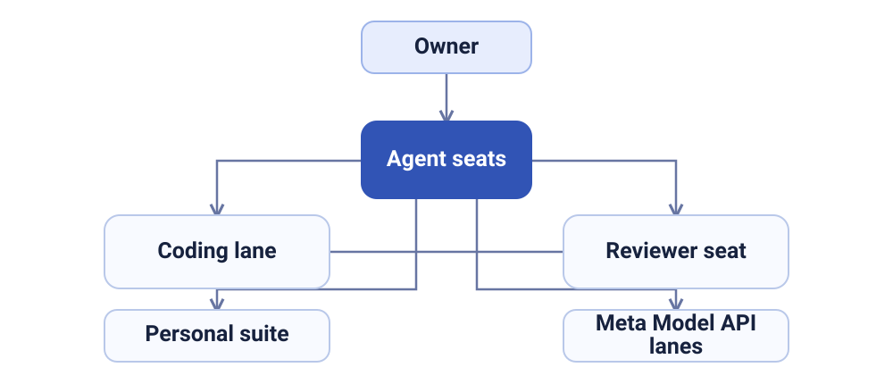

# Suite Fleet

I run a personal agent fleet that handles my real daily work on one small server. For the Meta Global AI Developer Hackathon (Indie Developer track, October 26 to November 4, 2026), I am rebuilding its model layer on Meta models.

Demo site: https://demo.kaziprince.com

## The story

Suite Fleet is not a demo I assembled for this event. It is a working fleet of agents on one small server, and it already handles the ordinary work of my life: triaging my mail, scoring job leads, evaluating deals, and checking my notes, alongside a personal suite I use for mail, notes, files, and chat. I direct the fleet, and it works under hard approval gates that stay with me: spending money, sending messages to other people, and making submissions always wait for my approval.

With this hackathon build I am answering a practical question using real workloads instead of benchmarks: when I plug Meta's newest models into jobs my fleet already runs every day, what do they cost, how fast are they, and how good are the results, measured head to head against the models doing those jobs today?

## The hackathon layer

During the event window, I am wiring Meta models into four real jobs my fleet already runs:

1. Mail triage: sorting and summarizing incoming mail the way my fleet already does it daily.
2. Job lead scoring: rating job postings against my standing criteria.
3. Deal evaluation: judging whether a found deal is real, relevant, and worth acting on.
4. Notes QA: checking my notes for errors, gaps, and stale facts.

I measure every run on the same three axes and publish the results on a public dashboard:

1. Cost: what the run actually cost.
2. Latency: how long the run actually took.
3. Quality: whether the output was accepted, edited, or rejected when reviewed against the result my fleet already produces for the same job.

I am publishing the measurements, including the runs where the new models lose, because I will keep whichever model wins each job. The dashboard is my record of that decision being made in the open.

## What is in this repo

This repo is a curated public staging of my hackathon layer only. I am not publishing the production fleet itself, its data, or its configuration here.

- `README.md`: this file: the project story, architecture, and disclosure
- `LICENSE`: proprietary license: viewing and evaluation only
- `demo/`: the demo site source (index.html, styles.css), live at the demo link above

These pieces landed here as I built them during the event:

- `routing/`: the model routing layer that sends each fleet job to a chosen model lane and logs cost and latency
- `lanes/`: the Meta model lanes for mail triage and job lead scoring, with their ledgers and measured results
- `dashboard/`: the public results dashboard source that renders the measured runs
- `tools/`: the hardened builder lane launcher: builds run detached with a heartbeat log and a terminal exit marker, so a dropped session no longer loses the build

The measured lanes published here today are mail triage and job lead scoring. Deal evaluation and notes QA run in the fleet but have no measured runs published yet.

## Architecture

One server. Clear roles, deliberate handoffs, and approval gates that stay with me.

How a job flows: I set the work and the rules. My coordinating seat plans it and routes it. My helper seat does research, prep, and checks. My builder tools write the code. A second review pass checks builds before they move forward, and the coordinating seat reviews again before anything ships. The model lanes do the measured daily jobs. Approval gates for money, outbound messages, and submissions stay with me at every step.

## Disclosure

Plainly stated, because it matters to how this submission should be judged:

1. The fleet itself pre exists this event. The server, the agent seats, the personal suite, and the four daily jobs were all running before the event window opened. What gets built during the event window is the hackathon layer described above: the model routing layer, the Meta model lanes, the measurements, and the public dashboard, plus this demo site and repo.
2. The work in this repo is built and reviewed by an agent fleet running under the entrant's own account: a coordinating seat, a helper seat, and a second review pass, plus Muse and Codex as builders. These are seats and tools in the entrant's own setup. None of them is an external or independent party, and nothing in this repo presents them as one.
3. The entrant, Kazi Paruaz Prince, directs, decides, and audits. Direction, decisions, gate approvals, and final review are his; the fleet's seats do the finding, drafting, building, and checking under that direction.

## Limitations

Read these before quoting the dashboard numbers:

1. Owner verdicts were applied on October 30, 2026. Every published benchmark entry now carries the owner's accept, edit, or reject judgment for each model output: 43 accept, 40 edit, and 11 reject across 94 outputs, shown in the dashboard's Owner verdicts section. The agreement rates still measure only how often the two models agree with each other, not whether either was right; the verdicts are the ground truth layer, and they are one owner's judgments, not an independent audit.
2. One wording artifact is preserved on purpose. In the job scoring v2 high results, the model's written explanations repeatedly cite a "$2,000/year floor". That figure does not match the pay floor in the owner's standing criteria for these roles. The records are published exactly as generated, artifact included, because editing model output after the fact would make the rest of the ledger harder to trust. It is also the clearest small example of why an owner reviews the fleet's work before acting on it.
3. Costs are estimates. Token counts and latencies are recorded from the API responses; dollar figures are computed from the router config, where the Spark prices are placeholders, so totals should be read as comparisons, not as billed amounts.

## Links

1. Demo site: https://demo.kaziprince.com
2. GitHub: https://github.com/Kazi16/suite-fleet
3. GitLab: https://gitlab.com/kazi-paruaz-group/suite-fleet
4. LinkedIn: https://www.linkedin.com/in/kaziprince/
5. Visual guide (PDF): docs/visual-guide.pdf — a plain language explainer of the project, drafted with AI assistance (ChatGPT) and verified against the published results on October 30, 2026.

## License

Proprietary. Published for viewing and evaluation only; see LICENSE.
